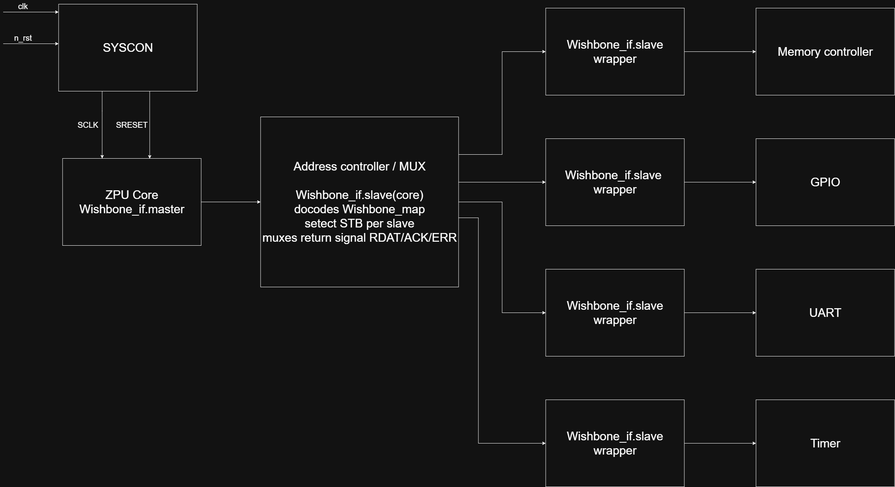
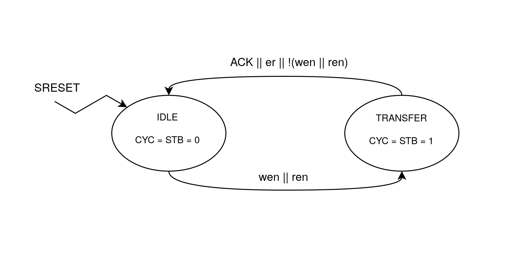
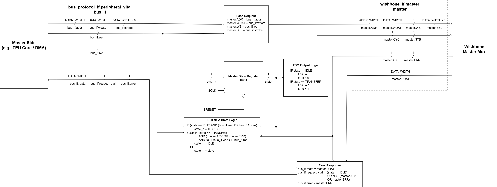
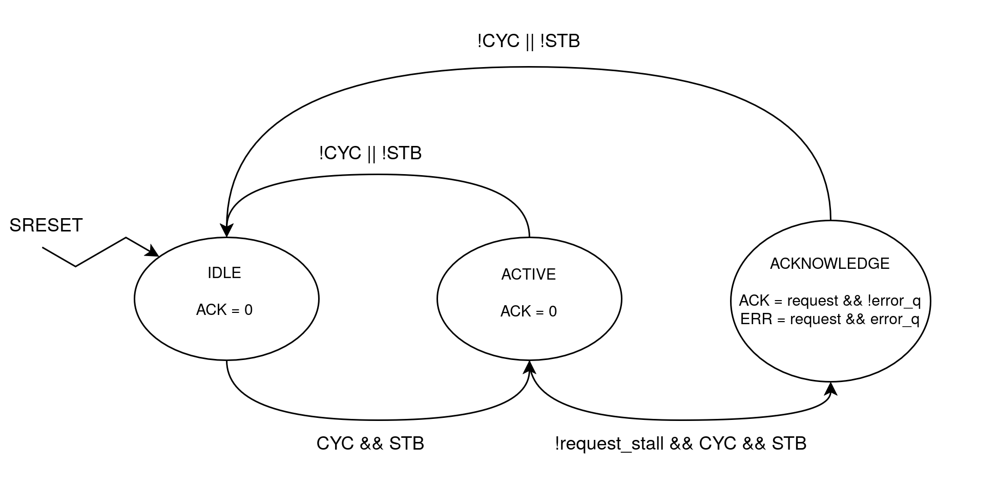
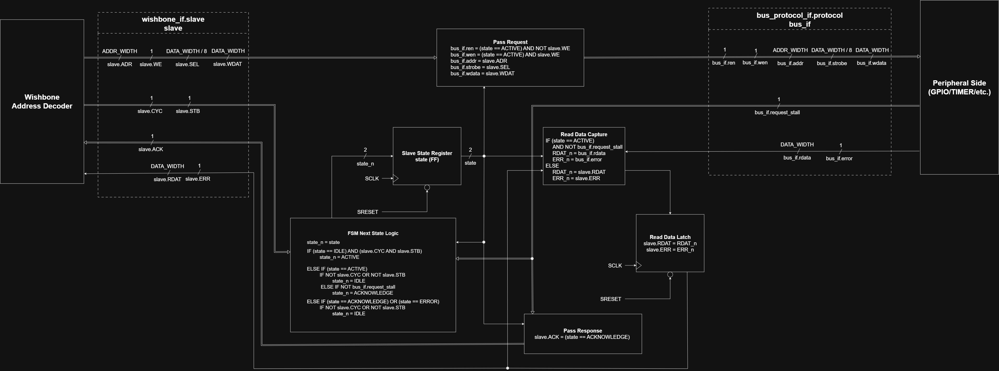
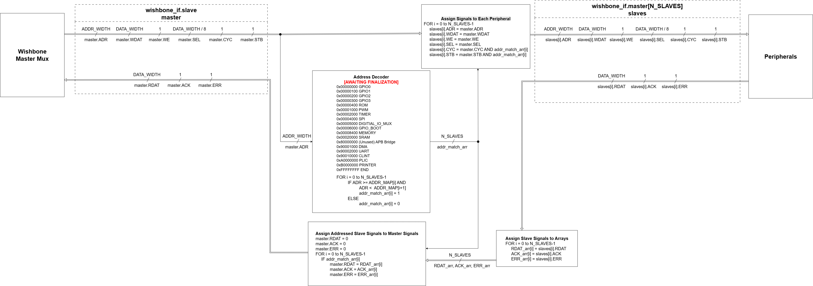
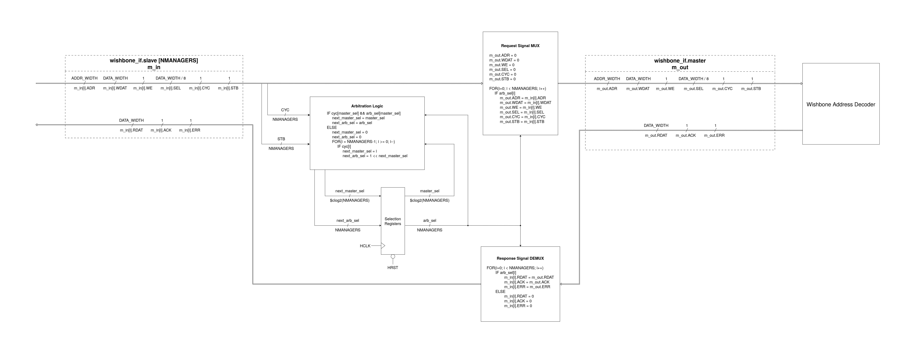

# Wishbone Bus & Memory
This document summarizes the useful takeaways from the design of Fall 2026 Wishbone Bus for ZPU-based SoC.

## Change Log
- **10/13/2026** (By Patchy Suanthong) Initial Document  : Add RTL and FSM Diagrams Section 

## RTL and FSM Diagrams
This section list all RTL and FSM diagrams highlighting internal operation of the Wishbone bus.

### Key Takeaways
- Wishbone Modules use `wishbone_if` interface to communicate internally, while using `bus_protocol_if` interface to communicate with external modules
- Peripherals use `bus_protocol_if.protocol` to connect to the Wishbone Slave Wrapper (`slave.sv`), which will port the signals into `wishbone_if.slave`.
- Masters (e.g., ZPU and DMA) use `bus_protocol_if.peripheral_vital` to connect to the Wishbone Master Wrapper (`master.sv`), which will port the signals into `wishbone_if.master`.

### Top Level Diagram
This diagram visualizes how Wishbone bus will connect SoC components together.

*Top-Level Diagram*

### Master Wrapper Diagrams
These diagrams visualize how `master.sv` translates between `bus_protocol_if.peripheral_vital` and `wishbone_if.master`. Notice the timing of the FSM.

*Master Wrapper FSM Diagram (Outdated)* 

*Master Wrapper RTL Diagram*

### Slave Wrapper Diagrams
These diagrams visualize how `slave.sv` translates between `bus_protocol_if.protocol` and `wishbone_if.slave`. Notice the timing of the FSM and the rdata capture register.

*Slave Wrapper FSM Diagram (Outdated)*

*Slave Wrapper RTL Diagram*

### Address Decoder Diagram
This diagram visualizes how `address_decoder.sv` route master to correct slave modules and vice versa based on master.ADR signal using combinatorial logic.  

*Address Decoder RTL Diagram*

### Master Mux Diagram
This diagram visualizes how `mux.sv` arbitrate access between multiple masters. Notice the timing of the selection register.

 
*Address Decoder RTL Diagram*